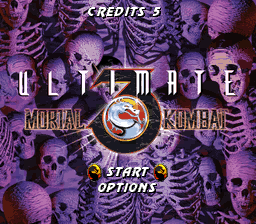
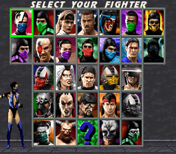
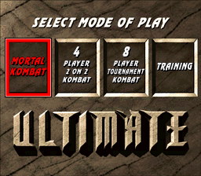
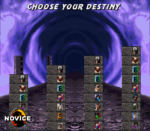
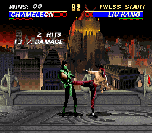

# UMK3 - Extended Edition

A Super Nintendo hack of **Ultimate Mortal Kombat 3**. It includes everything from Lucas Dext5r's UMK3 Deluxe (MK3 stages, Sheeva, Chameleon, stage fatalities) and uses Nemesis_C's Genesis "UMK3 Arcade" hack as a reference.

UMK3 Deluxe content is used with permission from its author, Lucas Dext5r.

**Download (beta 100):** [UMK3_extended_edition.zip](https://github.com/VrepliroidV/UMK3-SNES---Extended-Edition/raw/main/UMK3_extended_edition.zip). The zip has the IPS patch, an English README and the full changelog in Portuguese (LEIA-ME.txt). No ROM is included.

 
 

## How to apply

| | |
|---|---|
| Apply to | `Ultimate Mortal Kombat 3 (USA).sfc` (4 MB, no header) |
| Original ROM MD5 | `0644da71f79d405a22934daa1474cefc` |
| Patched ROM MD5 | `b6e25f74bbfebf98deedb09dedb5a35f` |

- The patched ROM is 8 MB (64 Mbit, ExHiROM). Use a patcher that can expand the file: Floating IPS, Lunar IPS, [ROM Patcher JS](https://www.marcrobledo.com/RomPatcher.js/) or UniPatcher.
- If your ROM is 4,194,816 bytes (512-byte header, common in `.smc` files), remove the header first.
- No MSU-1 needed. Tested in Snes9x and bsnes. Runs on emulators and flashcarts that support 64 Mbit ExHiROM (e.g. FXPak / SD2SNES); flashcarts limited to 32 Mbit will not run it.

## Latest changes (betas 57-97)

- **Beta 100:** One Button Fatalities reworked: each fighter walks to the right distance for his own fatality, Chameleon, Khameleon, Triborg and Human Smoke do their own, the stage fatality only on stages that have one, and the buttons for a finisher a fighter doesn't have do the normal move. In 4 PLAYER, 6 PLAYER and 8 PLAYER TOURNAMENT every pick has its own colours (Kano and MK3's Noob Saibot can be picked by the same player, and the bracket shows NOOB SAIBOT). Fixed garbage on the cheats screen in 2-player matches.
- **Beta 99:** Fixed: Shang Tsung had no second outfit (X on the select screen did nothing on him, nor on his opponent). Now both choose their colours; when Shang Tsung morphs into his opponent's fighter he always takes the other colours, so the two never look the same, and his other morphs keep the normal colours, as in the original game.
- **Beta 98:** Sheeva: the fatality where she punches the opponent into the floor now works on every stage (on The Temple and the Graveyard the opponent used to vanish, elsewhere the buried body showed above the floor); her second fatality (hold HK, Back, Forward, Forward, release, close) is now in the MOVELIST; fixed her throws by Kitana, Jade, Khameleon and Mileena and the knockdowns of the moves new in UMK3, which used leftovers from MK3. Chameleon: Down, Up (the teleport) only once per combo. Fixed: Noob Saibot's slam fatality threw two bursts of bones with two skulls, one of them from a random place in memory, which could freeze a real console; now one burst comes out of the opponent. The TOURNAMENT MODE screen (L+R+START in the main menu) was removed. Fixed: The Temple's candle flames and wall torches after the TRAINING menu and after a PAUSE.
- **Beta 97:** New **cheats screen**: the screen with the cheat codes that are on now comes up only before the first fight of a tower (and before each 2-player match), or again if the codes change, no longer before every round. Noob's Dorfen is behind it and Shao Kahn stands on the left: he laughs, points at you saying "You weak pathetic fool" and strikes his victory pose; THIS PLAYER ACTIVATED CHEATS stays at the top with the codes centred under it, and START does not skip it. Scorpion's Lair: a new sound when the stage fatality sends the opponent into the lava. Fixed: Sheeva's ending showed Kano's text; she now has her own ending (the text from MK3 for SNES). Fixed: Rain had no ending (the game went straight to the cast); his ending text, left unused in the original game, now comes up.
- **Beta 96:** **PAUSE** in every fight: START pauses (the fight is frozen and darkened, PAUSE in big gold letters, the music lower) and START again goes back exactly where it was. SELECT opens BACK / MOVELIST / EXIT: BACK returns to PAUSE, EXIT gives up the fight and goes to the main menu (the tower starts again from CHOOSE YOUR DESTINY). **MOVELIST**: each fighter's special moves and finishers, shown with the SNES buttons of your own controller setup and the arrows for the side you face; it is in the PAUSE menu and in the TRAINING menu (SELECT). TRAINING: new option FATALITY TIME (NORMAL / INFINITE). Fixed: in Motaro x Motaro the tail fireballs bounced back and forth and one could take over player 1's Motaro (drawn all over the stage, then the game hung); now Motaro throws back only a projectile nobody has thrown back yet. Fixed: Rain's fatality (Down, Down, Back, Fwd + HK) now shows the FATALITY text. ENABLE PAUSE is no longer in the cheat list.
- **Beta 95:** **TRAINING** without the VS screen (the fight starts right after the select screen). Changing DUMMY to or from CPU now happens in the same fight, without starting it again. With FINISH ON the other options are fixed (DUMMY STAND, BLOCK OFF, LIFE FINISH, RUN NORMAL) and shown in dark red; turning FINISH off gives your choices back. Yellow TRAINING title. Fixed: while the menu was open a fighter who was moving (running, thrown) kept moving and could leave the stage; the fight is now fully frozen. The J in JUMP no longer looks like a T.
- **Beta 94:** **TRAINING mode with its own menu.** After the VS screen the fight starts frozen with the TRAINING menu on top: DUMMY (STAND / CROUCH / JUMP / CPU / PLAYER 2, controller 2 plays the opponent), BLOCK (OFF / ON / RANDOM), LIFE (INFINITE / REFILL), RUN (NORMAL / INFINITE) and FINISH (every round is the deciding one and the opponent has 1 point of health: one hit and it's FINISH HIM / HER, to practise fatalities, babalities and mercy; afterwards a new round starts). In the fight START opens the menu: START goes back exactly where the fight was, B to the mode screen, X to the select screen. The cheat menus' codes have no effect in training; START + SELECT is no longer used. On the mode select screen B goes back to the main menu.
- **Beta 93:** **8 PLAYER TOURNAMENT** fixes: the bracket shows the names of Sheeva, Chameleon, Motaro, Shao Kahn, Khameleon and Triborg (it drew garbage), and Khameleon / Triborg stay themselves when they win a match (they went up the bracket, and into the next match, as Jade / Smoke).
- **Beta 92:** new hidden stage **Noob's Dorfen**, as in MK3: The Balcony without its back wall and the two Motaro statues, in dark colours, with the Hidden Portal's music. It is the 18th Kombat Zone stage and always the stage of Shao Kahn's treasure 6.
- **Beta 92:** **MK3's Noob Saibot** (Kano in black). Shao Kahn's treasure 6 (the silhouette) is now a fight against him alone; Ermac moved to treasure 7 with Classic Sub-Zero and Human Smoke. Beat him and, until the game is switched off, SELECT on Kano at the select screen turns Kano all black, and again black and grey: he plays as Kano, but the life bar says NOOB, the announcer calls him Noob Saibot and the win text is NOOB SAIBOT WINS. X on Kano still switches his two normal colours.
- **Beta 91:** the **mode select screen** has new art by Repliroid do Futuro (darker stone). The red frame of the chosen window now blinks between red and a darker red, and the mode names stay white in the chosen window too.
- **Beta 90:** fixed: after beating Shao Kahn in 1 player the game stopped on a red screen (betas 84-89), so **Shao Kahn's Lost Treasures** and the endings never came up. Classic Sub-Zero's friendship (beta 84) had overwritten a few bytes of the music data played after Kahn's death. The winner text, the treasures and the endings are back.
- **Beta 89:** new **mode select screen**, art by Repliroid do Futuro: four windows side by side, MORTAL KOMBAT | 4 PLAYER 2 ON 2 KOMBAT | 8 PLAYER TOURNAMENT KOMBAT | TRAINING. Left / Right move between the four (TRAINING is now the fourth window); L / R on the second window switch it to 6 PLAYER 3 ON 3 KOMBAT and back. The chosen window gets a red frame and red text, and the screen shakes when a mode is picked, as before.
- **Beta 89:** main menu: the small coins next to the options now show up in the right place when you enter or come back to a menu, with a fade-in, and follow Up / Down at once.
- **Beta 88:** the ice ball of Sub-Zero, Classic Sub-Zero and Chameleon no longer freezes crouching fighters. Its hit area clipped the heads of some of them when crouching (Classic Sub-Zero: Kano, Kabal, Shang Tsung, Kitana, Jade, Mileena, Khameleon; Sub-Zero: Shang Tsung). It is now a little higher; standing fighters are hit as before.
- **Beta 87:** Rain's **Friendship**: he keeps his hand up only while the rain falls. As soon as the last drop reaches the floor he does his victory pose; the flowers stay.
- **Beta 86:** Classic Sub-Zero's head rip (Down, Down, Down, Fwd + HP, close): the black screen with SUBZERO WINS, FLAWLESS VICTORY and FATALITY no longer flickers. Sub-Zero no longer shows for a frame or two, and stage sprites (the fire torches and the moon of some stages) no longer show through. Checked on every stage.
- **Beta 85:** Rain gets the **Friendship** from Mortal Kombat Trilogy (N64): Down, Fwd, Fwd, Fwd + LP (B), from a sweep's distance, at FINISH HIM, without blocking in the round. He raises his arm (his lightning move) and keeps it up; water drops fall on the opponent and small flowers grow on the floor around it (sprouts, then open, then in full bloom). The rain stops little by little and the flowers stay.
- **Beta 85:** Classic Sub-Zero's fatality where the screen goes black (Down, Down, Down, Fwd + HP, close): after the head rip the screen stays black, but SUBZERO WINS, FLAWLESS VICTORY (when the fight was perfect) and FATALITY now show on it.
- **Beta 84:** Classic Sub-Zero gets the snowman-in-a-box **Friendship** from Mortal Kombat Trilogy (N64): Down, Back, Back, Fwd + LK (A), from a sweep's distance, at FINISH HIM, without blocking in the round. He winds the ninjas' music box and a snowman head pops out on a blue neck; the opponent gets scared and runs away.
- **Beta 84:** Nightwolf's fatality (Up, Up, Back, Fwd + Block, close): the skeleton shows inside the light beam again, the beam reaches the top of the screen (behind the HUD) and thins out at the end, as in the original. Its frames with the skeleton were too big for the per-frame graphics limit the hack uses in fights and never got drawn.
- **Beta 83:** Noob Saibot gets the **Shadow Spin** fatality from Mortal Kombat Trilogy (N64): Back, Back, Fwd, Fwd + HK (X), from a sweep's distance, at FINISH HIM. He raises his hand and keeps it up; his shadow comes down over the (still dizzy) opponent to its waist, the opponent rises with it and spins as in Sindel's hair fatality, spraying blood and bones.
- **Beta 83:** Noob's fatality (Down, Down + Run, close): he teleports only once; when he lands holding the opponent he keeps hold and slams it on the floor again and again, bouncing high and moving forwards, until it blows up. It does not come out if the slams would take the opponent to the edge of the stage (in a corner).
- **Beta 82:** Classic Sub-Zero's Ice Spike: the opponent again lands with the spike nearer its waist. In beta 80 the spike went through the chest, but some fighters land on it in their lying-on-the-floor frame, and for them that spot looked wrong.
- **Beta 81:** Rain gets the **Deadly Uppercut** fatality (from the MUGEN Rain): Fwd, Fwd, Down + HP (Y), close, at FINISH HIM. He crouches and shakes from side to side for a second and a half, then does the last uppercut of his brutality: the opponent blows up, with the explosion sound, the scream, the screen shaking and the pieces.
- **Beta 80:** Classic Sub-Zero gets the **Ice Spike** fatality from Mortal Kombat Trilogy (N64): Down, Fwd, Fwd, Fwd + HP (Y), close, at FINISH HIM. He uppercuts the opponent, throws his ice on the floor (his Down, Back + LK move), a big ice spike rises from the middle of the ice and the opponent falls on it lying on the back, run through the chest, screaming and spraying blood. The ice and the spike stay to the end. It does not come out with the opponent against the corner (there must be room for it to land on the spike): then it is a normal uppercut.
- **Beta 80:** Noob Saibot's fatality (Down, Down + Run, close) could never be done: the Deluxe had its command written wrong. It works now.
- **Beta 79:** select screen: fixed the garbage on the bottom row of the "?" slot (an animated glitch) and the gray/white pieces on the P1 preview (e.g. Kitana), seen e.g. in the 6-player mode. When the last round of a match ended at FINISH HIM (a 2-player win, a continue in 1 player...), the game still thought a fight was on, and the next select screen gave the previews their fight shadows, whose graphics went over the "?" slot and the P1 preview. The select screen now always starts with the fight over.
- **Beta 79:** select screen: both cursors are 1 pixel higher.
- **Beta 79:** CHOOSE YOUR DESTINY: the GOD tower no longer shows up, now and then, as a row of 9 Endurance fights with no Motaro and no Shao Kahn (a Deluxe test row in one of the game's 6 tower sets). It is a normal GOD tower again, as in the original game, with Noob Saibot in place of the original's second Liu Kang.
- **Beta 79:** Hidden Portal: the bridge's pillars now reach the bottom of the screen (there was an empty strip under them and the bridge looked like it was floating).

- **Beta 78:** new name: **UMK3 - Extended Edition** (it was UMK3 Arcade Edition). The CREDITS screen (OPTIONS) and the name emulators and flashcarts show (the ROM header, "UMK3-EXTENDED EDITION": it holds 21 characters) use it. The patch is now `UMK3_extended_edition.ips`, in `UMK3_extended_edition.zip`.

- **Beta 77:** Shao Kahn's Lost Treasures: the demonstrations no longer break. After a few minutes of the last treasure (all the demonstrations), the background turned into a bright, shifted temple, the fighters came out in pieces and the top of the screen filled with garbage until the GAME OVER. Triborg's variables were in a piece of memory the game also uses when many processes run at once, and the demonstrations fill it: the two overwrote each other. They are in free memory now.
- **Beta 77:** Shao Kahn's Lost Treasures: the fatality music plays in every demonstration (it played only in the first one, then there was silence).

- **Beta 76:** select screen: new background picture (a dark stone wall over a stone floor), and the grid's outer border is now drawn like the lines between the slots.

- **Beta 75:** Triborg's juggle: the jump kick now knocks the opponent away with the game's normal fall (like any hit in the air: a short rise, then the diagonal fall). The slower fall of beta 73 looked odd. The teleport still catches the opponent in the air.
- **Beta 75:** Triborg's juggle: the spear comes out only once in a string. If the spear opened it (spear, then HP, HP, Down + LP...), it no longer comes out again after the teleport; Back, Back + LP gives the normal punch until the string is over.
- **Beta 75:** Triborg: HP, HP, Down + LP in the corner now pushes him back and keeps him in the combo's last frame until the opponent comes down, as the game does (e.g. Sektor). He used to recover right away and could rush the cornered opponent. The juggle therefore goes on only from mid-screen.
- **Beta 75:** heavy fights (e.g. Motaro vs Shao Kahn in the tower): fixed the flicker where the whole HUD (life bars, names) vanished for a frame. When a frame's work ran late, a few screen registers were written after the top of the next frame had started and turned the HUD layer off. They are written earlier now; a late frame only leaves 1-2 black lines at the very top.

- **Beta 74:** Triborg's juggle no longer uses the net: during the juggle Back, Back + LK gives the normal kick (Cyrax's own rule), and a net that catches an opponent who has already landed starts a new string (the combo after it is a first one again). After the teleport, the spear goes on with the juggle. The net works as before outside the juggle, and the net followed by the combo still opens a juggle.
- **Beta 74:** "YOU UNLOCKED TRIBORG" screen: the text is no longer part of the picture. The three lines are real sprites in the font of "SHAO KAHN IS NO MORE" and rise from the bottom one after the other, as on that screen.

- **Beta 73:** Triborg's juggle: after the jump kick the opponent now falls away on the diagonal (it used to go up again). The fall is a bit slower, so the teleport still catches it in the air.
- **Beta 73:** Shao Kahn's Lost Treasures: fixed the fatality demonstrations. The Deluxe had changed 5 of the game's 8 demo lists into pairs where both fighters did a finisher at once (friendship + babality, two fatalities, animalities), which broke the scenes. They are back to the original lists: one fighter does his fatality, the other stands. Treasure 9 shows everything (fatalities 1 and 2, then friendships and babalities two at a time, as in the original game).
- **Beta 73:** Nightwolf's friendship: the MK2 arcade cabinet that falls next to him no longer flashes through the ninja colors (Chameleon's color cycle was catching its palette).

- **Beta 72:** Shao Kahn's Lost Treasures: after you beat Shao Kahn in 1 player, the treasure screen comes up, as in the arcade (the SNES game only had it in the 8-player tournament), with the menu music. Treasure 0 goes on to your ending; treasures 6 and 7 are the original Endurance fights (Noob Saibot + Ermac, Classic Sub-Zero + Human Smoke) on normal stages; treasure 8 is a fight against **Triborg**.
- **Beta 72:** new hidden fighter, **Triborg**: the three cyborgs in one (Cyrax, Sektor and Smoke), with their colors cycling. Beat him in treasure 8 to unlock him (a "YOU UNLOCKED TRIBORG" screen shows up), then press SELECT on the "?" slot of the select screen. The game has no save: he stays unlocked until you turn it off or reset.
  - Cyrax's net (Back, Back + LK) and bombs (hold LK, Fwd, Fwd + HK far / Back, Back + HK close); Sektor's missile (Fwd, Fwd + LP) and homing missile (Fwd, Down, Back + HP); Smoke's spear (Back, Back + LP), teleport punch (Fwd, Fwd + LK, also in the air), air throw (Block in the air) and invisibility (Up, Up + Run).
  - Combos: HP, HP, Down + LP (launcher); HP, HP, HK, HK; HP, HP, LK, HK, LP.
  - Juggle: after HP, HP, Down + LP, jump in with a kick, teleport in the air (it knocks the opponent up again), land and throw the spear, do the combo again; then only normal hits and the air throw work until the opponent lands (the net: see beta 74).
  - Fatalities: Cyrax Down, Down, Up, Down + HP; Sektor Fwd, Fwd, Fwd, Back + Block (far); Smoke Up, Up, Fwd, Down (hold Block, far). Smoke's brutality: Y, A, A, X, L, L, B, B, Y, L, L (HP, LK, LK, HK, BL, BL, LP, LP, HP, BL, BL).
  - His own select and tower portraits, VS art, life bar name, "TRIBORG WINS", announcer voice, Smoke's victory pose, biography ("???" until he is unlocked) and ending; no smoke cloud around him. He also works in the team modes.
- **Beta 72:** player Motaro: new tail fireball (it comes out of the tip of his tail) with Down, Back + LK, and the screen shakes when he lands from a jump.
- **Beta 72:** Motaro's grab (CPU and player) no longer does damage when it catches; only the punch hurts, also when the opponent is blocking.
- **Beta 72:** Noob Saibot's teleport throw on Sheeva: she no longer ends up far from him in Sonya's pose; she is held like everyone else.
- **Beta 72:** Khameleon: after a Mercy the announcer no longer says "Jade".

- **Beta 71:** the game's version is shown on the OPTIONS screen, small, in the bottom right corner on the CREDITS line (VER.BETA71).
- **Beta 71:** tower and 2-player stages are now picked at random from all 17 (each one once before any repeats, never the same twice in a row). The tower used to go through the same order every time, MK3 stages first, and the first fight after power-on was always on the Rooftop. The CPU Motaro and Shao Kahn keep their own stages, and KOMBAT ZONE still picks the stage.
- **Beta 71:** Endurance fights have random opponents (no repeats, never your own fighter); they used to be the same pairs (Kitana then Sheeva, Jax then Nightwolf).
- **Beta 71:** fixed a tower freeze: sometimes a stage (e.g. Jade's Desert) showed up with no fighters, only the music. Some of the hack's variables were in the memory the game uses for its processes, and with many of them at once (Sheeva, Scorpion's Lair, Hidden Portal) the game got lost.
- **Beta 71:** The Pit 3: during the stage fatality, as the camera goes down, the names and life bars no longer vanish or break.
- **Beta 71:** Motaro fights (worse with Chameleon): fixed the short picture glitches (HUD and floor drawn a few lines off for one frame). In the heaviest frames the end-of-frame work ran out of time; the scanline effects (HUD, floor) now always start in place.
- **Beta 71:** air throws on Liu Kang (Human Smoke, Scorpion): he no longer pops up behind the attacker when he lands.
- **Beta 71:** Khameleon's brutality now uses Mileena's commands: Y, B, B, Y, L, X, A, X, L, Y, B (HP, LP, LP, HP, BL, HK, LK, HK, BL, HP, LP). Jade keeps hers.
- **Beta 71:** when Shao Kahn wins a round the announcer says "I Win". The clip was already there, but it was asked for right away and the blood dripping on the floor took its voice; it now waits for the loser's scream to end.
- **Beta 71:** removed every leftover of the Deluxe's animality (the game has no animality commands): the CPU's path to it, its table, its sounds and the "Animality" call. More free space in the ROM.

- **Beta 70:** CPU Motaro: his grab no longer pulls the opponent in from far away at once; he reaches out first (time to get away), only catches someone in reach and on the ground, and does not try from too far. Grabbed by the player's Motaro, he no longer hangs in the air after the punch. At the end of a combo he rears back and slides away much further, then waits a moment before attacking. Motaro (CPU and player) takes the heavy hit sound on the punch of the grab, on uppercuts and on the last hit of a combo.
- **Beta 69:** fixed: pressing HP over and over made Khameleon throw Mileena's sai by accident. The sai now comes out only the proper way (hold HP, let go); mashing HP gives the punches and the combo.
- **Beta 68:** Khameleon has her own ending: her story on one screen over Jade's picture with Khameleon's colors cycling (it used to be Jade's ending).
- **Beta 67:** the CPU Khameleon now uses her own moves: Kitana's fan, Mileena's sai and Jade's boomerangs, picked at random (the game's AI picked her moves as Jade's).
- **Beta 67:** CHOOSE YOUR DESTINY: the 4th tower shows GOD again (beta 66 showed "KHAMELEON W..." there).

- **Beta 66:** new fighter **Khameleon** (the Nintendo 64 Mortal Kombat Trilogy ninja), in Human Smoke's old slot. She cycles through Kitana's, Jade's and Mileena's colors and uses moves from all three:
  - Kitana's fan (Fwd, Fwd + HP + LP); Jade's boomerangs (Back, Fwd + HP / LP / LK; Back, Back, Fwd + LP); Mileena's sai (hold HP, let go); Mileena's throw.
  - Combo: HP, HP, LP, LP, HK, HK, Down, Fwd + LK (7 hits, launcher).
  - Fatalities (close): Kitana's kiss (Run, Run, Block, Block + LK), Mileena's man-eater (Down, Fwd, Down, Fwd + LP), Jade's staff (Up, Up, Down, Fwd + HP). Stage fatality: Down, Down, Down + LP. Jade's friendship and babality.
  - Own select and tower portraits, VS art, life bar name, "KHAMELEON WINS", announcer voice and biography; works in the tower, team modes and tournament.
- **Beta 66:** Human Smoke is now on Smoke's slot: press SELECT on Smoke to swap the portrait (with a fade) to Human Smoke and back. Random select never picks Human Smoke.
- **Beta 66:** the X button on the select screen picks the fighter's color (the second outfit used to show up only on P2 in a mirror match); X no longer picks the fighter. Ermac and Noob got their second color back (darker red Ermac, all-black Noob, as in UMK3).
- **Beta 66:** Hidden Portal: no fighters running across the bridge and no Shao Kahn laugh before the fight.
- **Beta 66:** stage fatalities: Chameleon's is now Fwd, Down + HP (Y); Mileena's (Down, Down, Down + LP) had to be done in 0.4 s, now 0.7 s; Soul Chamber no longer has one (the opponent got up again); the Subway train passes 3x faster.

- **Beta 65:** fixed the life bar glitch seen on some emulators and flash carts (a colored block over a letter of the name, a broken run meter). The HUD no longer changes a palette color mid-screen; the letters over the red part of a bar are now all white.

- **Beta 64:** BIOGRAPHIES is now an item of the SECRET STUFF screen, right under SOUND TEST, in the big font (it used to be inside KOOLER STUFF).

- **Beta 63:** Ermac's fatality 2 (head punch: Run, Block, Run, Run, HK, close) can now be performed. On the original SNES cart a stray byte between Ermac's HK move list and Human Smoke's (where that shared fatality entry is) made the game read the entry one byte off, so only the one-button fatality cheat could do it.

- **Beta 62:** Motaro and Shao Kahn picked by a player can now fight on any stage (the normal order or the KOMBAT ZONE pick). CPU bosses in the tower still fight on their own stages, as in the arcade.
- **Beta 61:** playable Motaro: landing from a jump has a sound again (the same thud the CPU Motaro uses).
- **Beta 60:** fixed a crash on Liu Kang's fatality (Fwd, Fwd, Down, Down, LK): a Chameleon table entry was written 2 bytes too far, over the start of that fatality's code. It also restores three of Motaro's position values.

- **Beta 59:** fixed the graphics glitch in fights with Motaro and/or Shao Kahn (e.g. Motaro vs Shao Kahn): pink dots on the floor and background, wrong colors on the fighters. In the heaviest frames the end-of-frame work ran out of time and the scanline effects were turned on without being reset, writing random colors into the palettes. They are now reset when that happens, and the sprite graphics sent per frame in a fight are capped a bit lower so it almost never happens.
- **Beta 59:** Bell Tower: fixed occasional frames with the whole screen garbled (e.g. Chameleon vs Jax doing combos). The rope drawing code is about 4x faster.
- **Beta 58:** Liu Kang: after his launcher combo (HP, HP, Back+LP), every later hit did only 1/4 of the damage until the end of the round. Fixed.
- **Beta 57:** The Bridge: the gap under the floor is filled like on the other stages. Jump-in HP + combo now connects on Kitana, Jade and Mileena like on everyone else.

## Highlights

- Arcade-style select screen (7/7/5/5/5) with everyone unlocked: Sheeva, Chameleon, Khameleon, Motaro and Shao Kahn, each with a slot and portrait (SELECT on Smoke swaps to Human Smoke). "?" slot = random select.
- Chameleon cycles through every ninja's colors, has one special move from each ninja, his own name, announcer voice, brutality and green blood.
- Khameleon cycles through Kitana's, Jade's and Mileena's colors, with moves, combo and one fatality from each of them.
- **Triborg** (hidden): Cyrax, Sektor and Smoke in one, with moves, combos, a juggle and one fatality from each of them. Unlock him by beating him in Shao Kahn's Lost Treasures, which now come up after beating Shao Kahn in 1 player.
- X on the select screen picks each fighter's second outfit.
- Motaro and Shao Kahn get big VS-screen art and biographies; Motaro can't be launched or juggled.
- Arcade intro story, redesigned main menu and mode select, CHOOSE YOUR DESTINY tower with the GOD tower.
- Fighter names inside the life bars, as in the arcade.
- Air combos for Kitana, Jade and Mileena.
- **TRAINING mode** with its own menu: the opponent can stand, crouch, jump, block (always or at random), be the CPU or player 2; infinite or refilling health, infinite run, a FINISH option to practise fatalities, babalities and mercy, infinite FATALITY TIME and the MOVELIST. START freezes the fight and opens the menu, and every change (CPU included) takes effect in the same fight; KOMBAT ZONE stage select.
- **PAUSE** in every fight (START), with a **MOVELIST** of each fighter's special moves and finishers shown with your own SNES buttons, and EXIT to the main menu.
- Random stage order in the tower and 2-player fights; random Endurance opponents.
- KOMBAT ZONE stage select, OPTIONS > CREDITS screen, many sound, announcer and graphics fixes, less slowdown in the boss fights.

## Credits

- UMK3 Deluxe: Lucas Dext5r (2022)
- Original MSU-1 patch: Kurrono, Relikk, Conn
- Genesis "UMK3 Arcade" hack (reference): Nemesis_C
- This patch: Repliroid do Futuro (Gabriel Calmon)

---

## Português

Hack de **Ultimate Mortal Kombat 3** para Super Nintendo. Traz tudo do UMK3 Deluxe do Lucas Dext5r e usa a hack de Mega Drive "UMK3 Arcade" do Nemesis_C como referência.

O conteúdo do UMK3 Deluxe é usado com a permissão do autor, Lucas Dext5r.

**Download (beta 100):** [UMK3_extended_edition.zip](https://github.com/VrepliroidV/UMK3-SNES---Extended-Edition/raw/main/UMK3_extended_edition.zip). O zip tem o patch IPS, um README em inglês e o LEIA-ME.txt com todas as novidades em português. A ROM não vem junto.

Aplique na `Ultimate Mortal Kombat 3 (USA).sfc` original (4 MB, sem cabeçalho, MD5 `0644da71f79d405a22934daa1474cefc`). Depois do patch a ROM fica com 8 MB e MD5 `b6e25f74bbfebf98deedb09dedb5a35f`.

### Novidades recentes (betas 57-97)

- **Beta 100:** One Button Fatalities refeito: cada lutador anda até a distância certa do fatality dele, Chameleon, Khameleon, Triborg e Human Smoke fazem os deles, o stage fatality só nas fases que têm, e os botões de uma finalização que o lutador não tem fazem o golpe normal. No 4 PLAYER, 6 PLAYER e 8 PLAYER TOURNAMENT cada escolha tem as suas próprias cores (o mesmo jogador pode escolher o Kano e o Noob Saibot do MK3, e a chave mostra NOOB SAIBOT). Correção do lixo na tela dos cheats em partidas de 2 jogadores.
- **Beta 99:** Correção: o Shang Tsung estava sem a cor alternativa (o X na seleção não fazia nada nele, nem no oponente dele). Agora os dois escolhem a cor; quando o Shang Tsung se transforma no lutador do oponente ele fica sempre com a outra cor, para os dois nunca ficarem iguais, e nas outras transformações fica a cor normal, como no jogo original.
- **Beta 98:** Sheeva: o fatality de socar o oponente para dentro do chão agora funciona em todas as fases (no Temple e no Graveyard o oponente sumia, nas outras o corpo enterrado aparecia por cima do chão); o segundo fatality dela (segurar HK, trás, frente, frente, soltar, perto) agora está no MOVELIST; corrigidos os arremessos dela pela Kitana, Jade, Khameleon e Mileena e a queda dos golpes novos do UMK3, que usavam restos do MK3. Chameleon: o Baixo, Cima (teleporte) só uma vez por combo. Correção: o fatality do Noob Saibot de quicar o oponente soltava duas rajadas de ossos com dois crânios, uma delas de um lugar qualquer da memória, o que podia travar o console; agora sai uma rajada só, do oponente. A tela TOURNAMENT MODE (L+R+START no menu) foi retirada. Correção: as velas e as tochas do Temple depois do menu do TRAINING e depois de um PAUSE.
- **Beta 97:** **Tela dos cheats** nova: a tela com os códigos ligados agora só aparece antes da primeira luta da torre (e antes de cada partida de 2 jogadores), ou de novo se os códigos mudarem; não aparece mais a cada round. O fundo é o Noob's Dorfen e o Shao Kahn fica na esquerda: ele ri, aponta o dedo dizendo "You weak pathetic fool" e faz a pose de vitória; THIS PLAYER ACTIVATED CHEATS fica fixo no topo com os códigos centralizados embaixo, e o START não pula a tela. Scorpion's Lair: som novo quando o stage fatality joga o oponente na lava. Correção: o final da Sheeva mostrava o texto do Kano; agora ela tem o final dela (o texto do MK3 de SNES). Correção: o Rain não tinha final (o jogo ia direto para o elenco); agora aparece o texto do final dele, que estava guardado sem uso no jogo original.
- **Beta 96:** **PAUSE** em todas as lutas: START pausa (a luta congela e escurece, PAUSE em letras grandes douradas, a música abaixa) e START de novo volta exatamente de onde parou. SELECT abre BACK / MOVELIST / EXIT: BACK volta ao PAUSE, EXIT desiste da luta e vai para o menu principal (a torre recomeça do CHOOSE YOUR DESTINY). **MOVELIST**: os golpes especiais e as finalizações de cada lutador, com os botões do Super Nintendo da sua configuração de controle e as setas do lado para onde ele está virado; está no menu do PAUSE e no menu do TRAINING (SELECT). TRAINING: opção nova FATALITY TIME (NORMAL / INFINITE). Correção: no Motaro x Motaro as bolas do rabo iam e voltavam e uma podia tomar o lugar do Motaro do jogador 1 (embaralhado pelo cenário, depois o jogo travava); agora o Motaro só rebate projétil que ninguém rebateu ainda. Correção: o fatality da Rain (baixo, baixo, trás, frente + HK) agora mostra o texto FATALITY. O ENABLE PAUSE saiu da lista de cheats.
- **Beta 95:** **TRAINING** sem a tela de VS (a luta começa logo depois da seleção). Trocar o DUMMY para CPU (ou da CPU para outra opção) agora vale na mesma luta, sem recomeçar. Com o FINISH ligado as outras opções ficam fixas e em vermelho escuro (DUMMY STAND, BLOCK OFF, LIFE FINISH, RUN NORMAL); desligando o FINISH, as escolhas de antes voltam. Título TRAINING em amarelo. Correção: com o menu aberto, um lutador em movimento (correndo, sendo arremessado) continuava andando e podia sair do cenário; agora a luta fica totalmente congelada. O J de JUMP não parece mais um T.
- **Beta 94:** **modo TRAINING com menu próprio.** Depois da tela de VS a luta começa parada, com o menu do TRAINING por cima: DUMMY (STAND / CROUCH / JUMP / CPU / PLAYER 2, o controle 2 controla o oponente), BLOCK (OFF / ON / RANDOM), LIFE (INFINITE / REFILL), RUN (NORMAL / INFINITE) e FINISH (todo round é o decisivo e o oponente tem 1 ponto de vida: um golpe e vem o FINISH HIM / HER, para treinar fatality, babality e mercy; depois começa um round novo). Na luta, START abre o menu: START volta exatamente de onde parou, B vai para a tela de modos e X para a tela de seleção. Os códigos dos menus de cheats não valem no training; START + SELECT não são mais usados. Na tela de modos, B volta para o menu principal.
- **Beta 93:** correções no **TOURNAMENT de 8 jogadores**: a chave mostra os nomes da Sheeva, do Chameleon, do Motaro, do Shao Kahn, do Khameleon e do Triborg (antes aparecia lixo na tela), e o Khameleon e o Triborg continuam sendo eles quando vencem uma luta (antes subiam na chave, e iam para a luta seguinte, como Jade e Smoke).
- **Beta 92:** fase escondida nova **Noob's Dorfen**, como no MK3: a The Balcony sem a parede do fundo e sem as duas estátuas do Motaro, escurecida, com a música do Hidden Portal. É a 18ª fase do KOMBAT ZONE e sempre a fase do tesouro 6 do Shao Kahn.
- **Beta 92:** **o Noob Saibot do MK3** (o Kano todo preto). O tesouro 6 (a silhueta) agora é uma luta só contra ele; o Ermac foi para o tesouro 7, junto do Classic Sub-Zero e do Human Smoke. Vencendo, até desligar o jogo, o SELECT no Kano na tela de seleção deixa o Kano todo preto e, de novo, preto e cinza: ele joga como o Kano, mas a barra de vida diz NOOB, o locutor diz "Noob Saibot" e o texto de vitória é NOOB SAIBOT WINS. O X no Kano continua trocando as duas cores normais dele.
- **Beta 91:** **tela de escolha do modo** com arte nova do Repliroid do Futuro (pedra mais escura). A moldura vermelha da janela escolhida agora pisca entre o vermelho e um vermelho mais escuro, e os nomes dos modos ficam brancos também na janela escolhida.
- **Beta 90:** corrigido: depois de vencer o Shao Kahn no modo de 1 jogador o jogo parava numa tela vermelha (betas 84 a 89), e os **tesouros do Shao Kahn** (Shao Kahn's Lost Treasures) e os finais nunca apareciam. O friendship do Classic Sub-Zero (beta 84) tinha ficado em cima de alguns bytes dos dados da música que toca depois da morte do Kahn. Os textos do vencedor, a tela dos tesouros e os finais voltaram.
- **Beta 89:** **tela nova de escolha do modo**, com arte do Repliroid do Futuro: quatro janelas lado a lado, MORTAL KOMBAT | 4 PLAYER 2 ON 2 KOMBAT | 8 PLAYER TOURNAMENT KOMBAT | TRAINING. Esquerda e direita andam entre as quatro (o TRAINING agora é a quarta janela); L ou R na segunda janela troca para 6 PLAYER 3 ON 3 KOMBAT e volta. A janela escolhida fica com moldura e texto vermelhos, e a tela treme ao escolher, como antes.
- **Beta 89:** menu principal: as moedas pequenas ao lado das opções aparecem no lugar certo ao entrar e ao voltar de um menu, com fade, e acompanham Cima/Baixo na hora.
- **Beta 88:** a bola de gelo do Sub-Zero, do Classic Sub-Zero e do Chameleon não congela mais quem está agachado. A área de acerto pegava a cabeça de alguns personagens agachados (Classic Sub-Zero: Kano, Kabal, Shang Tsung, Kitana, Jade, Mileena, Khameleon; Sub-Zero: Shang Tsung). Agora ela fica um pouco mais alta; quem está em pé é atingido como antes.
- **Beta 87:** **Friendship** do Rain: ele fica com a mão para cima só enquanto a chuva cai. Assim que a última gota chega ao chão, ele faz a pose de vitória; as flores continuam no chão.
- **Beta 86:** fatality do Classic Sub-Zero em que a tela fica preta (baixo, baixo, baixo, frente + soco alto, de perto): a tela preta com SUBZERO WINS, FLAWLESS VICTORY e FATALITY não pisca mais. O Sub-Zero não aparece mais por um ou dois quadros e os sprites do cenário (as tochas de fogo e a lua de algumas fases) não aparecem mais. Conferido em todas as fases.
- **Beta 85:** o Rain ganhou o **Friendship** do Mortal Kombat Trilogy (N64): baixo, frente, frente, frente + soco baixo (B), na distância de uma rasteira, no FINISH HIM, sem ter usado a defesa no round. Ele levanta o braço (a animação do raio) e fica assim até o fim; caem gotinhas de água sobre o oponente e nascem flores pequenas no chão em volta dele (brotos, depois abertas e por fim desabrochadas). A chuva vai parando aos poucos e as flores ficam.
- **Beta 85:** fatality do Classic Sub-Zero em que a tela fica preta (baixo, baixo, baixo, frente + soco alto, de perto): depois do arranco da cabeça a tela continua preta, mas agora com SUBZERO WINS, FLAWLESS VICTORY (quando a luta foi perfeita) e FATALITY aparecendo.
- **Beta 84:** o Classic Sub-Zero ganhou o **Friendship** do boneco de neve na caixa do Mortal Kombat Trilogy (N64): baixo, trás, trás, frente + chute baixo (A), na distância de uma rasteira, no FINISH HIM, sem ter usado a defesa no round. Ele gira a manivela da caixa de música como os outros ninjas e sai uma cabeça de boneco de neve num pescoço azul; o oponente se assusta e foge correndo.
- **Beta 84:** fatality do Nightwolf (cima, cima, trás, frente + defesa, de perto): a caveira voltou a aparecer dentro do raio de luz, o raio vai até o topo da tela (por trás do HUD) e afina no final, como na versão original. Os quadros do raio com a caveira eram grandes demais para o limite de gráficos por quadro que a hack usa nas lutas e nunca eram desenhados.
- **Beta 83:** o Noob Saibot ganhou o fatality **Shadow Spin** do Mortal Kombat Trilogy (N64): trás, trás, frente, frente + chute alto (X), na distância de uma rasteira, no FINISH HIM. Ele levanta a mão e fica assim até o fim; a sombra dele vem por cima do oponente (ainda tonto) até a cintura, o oponente levita junto com ela e gira como no fatality do cabelo da Sindel, espalhando sangue e ossos.
- **Beta 83:** fatality do Noob (baixo, baixo + corrida, de perto): ele faz o teleporte uma vez só; ao pegar o oponente e tocar o chão ele não solta mais e fica batendo o oponente no chão, quicando alto e indo para a frente, até o oponente explodir. Não sai se as batidas forem levar o oponente até a borda do cenário (no canto).
- **Beta 82:** Ice Spike do Classic Sub-Zero: o oponente voltou a cair com o espinho mais perto da cintura. Na beta 80 o espinho pegava no peito, mas alguns lutadores caem no espinho com o mesmo quadro de quando estão caídos no chão, e com eles a posição do peito ficava ruim.
- **Beta 81:** o Rain ganhou o fatality **Deadly Uppercut** (do Rain do MUGEN): frente, frente, baixo + soco forte (Y), de perto, no FINISH HIM. Ele abaixa e fica tremendo para os lados por 1 segundo e meio, e dá o uppercut do fim do Brutality dele: o oponente explode, com o som da explosão, o grito, a tela tremendo e os pedaços espalhados.
- **Beta 80:** o Classic Sub-Zero ganhou o fatality **Ice Spike** do Mortal Kombat Trilogy (N64): baixo, frente, frente, frente + soco forte (Y), de perto, no FINISH HIM. Ele dá um uppercut, solta o gelo no chão (o mesmo golpe de baixo, trás + chute baixo), um espinho de gelo grande sobe do meio da poça e o oponente cai deitado de costas em cima dele, atravessado no peito, gritando e espalhando sangue. A poça e o espinho ficam até o fim. Não sai com o oponente encostado no canto (ele precisa de espaço para cair no espinho): aí sai só o uppercut normal.
- **Beta 80:** o fatality do Noob Saibot (baixo, baixo + corrida, de perto) nunca saía, porque o comando estava gravado errado no Deluxe. Agora sai.
- **Beta 79:** tela de seleção: corrigido o lixo na última fileira do "?" (um glitch animado) e os pedaços cinza/brancos na prévia do P1 (ex.: Kitana), vistos por exemplo no modo de 6 jogadores. Quando o último round de uma partida terminava no FINISH HIM (vitória no modo de 2 jogadores, continue no modo de 1 jogador...), o jogo continuava achando que havia uma luta, e a tela de seleção seguinte dava as sombras da luta para as prévias dos lutadores; os gráficos das sombras iam parar em cima do "?" e da prévia do P1. Agora a tela de seleção sempre começa com a luta encerrada.
- **Beta 79:** tela de seleção: os cursores dos dois jogadores subiram 1 pixel.
- **Beta 79:** CHOOSE YOUR DESTINY: a torre GOD não aparece mais, de vez em quando, como uma fileira de 9 lutas Endurance sem o Motaro e sem o Shao Kahn (uma fileira de teste da Deluxe num dos 6 conjuntos de torres do jogo). Ela voltou a ser uma torre GOD normal, como no jogo original, com o Noob Saibot no lugar do segundo Liu Kang do original.
- **Beta 79:** Hidden Portal: os pilares da ponte agora vão até o fim da tela (ficava uma faixa vazia embaixo deles e a ponte parecia flutuar).

- **Beta 78:** nome novo: **UMK3 - Extended Edition** (era UMK3 Arcade Edition). Aparece na tela de créditos (OPTIONS) e no nome que os emuladores e flashcarts mostram (cabeçalho da ROM, "UMK3-EXTENDED EDITION": cabem só 21 letras). O patch agora se chama `UMK3_extended_edition.ips`, dentro do `UMK3_extended_edition.zip`.

- **Beta 77:** Shao Kahn's Lost Treasures: as demonstrações não quebram mais. Depois de alguns minutos no último tesouro (todas as demonstrações), o fundo virava um templo claro e deslocado, os lutadores saíam em pedaços e o alto da tela enchia de lixo até o GAME OVER. As variáveis do Triborg ficavam num pedaço da memória que o jogo também usa quando muitos processos rodam ao mesmo tempo, e as demonstrações enchem esse pedaço: um sobrescrevia o outro. Agora elas ficam numa área livre.
- **Beta 77:** Shao Kahn's Lost Treasures: a música de finalização toca em todas as demonstrações (só tocava na primeira, depois ficava mudo).

- **Beta 76:** tela de seleção: nova foto de fundo (parede de pedra escura sobre um chão de pedra), e a borda de fora da grade agora é desenhada igual às linhas entre as casas.

- **Beta 75:** malabarismo do Triborg: o chute no ar agora joga o oponente com a queda normal do jogo (como qualquer golpe no ar: sobe um pouco e cai na diagonal). A queda mais lenta da beta 73 ficava esquisita. O teleporte continua pegando o oponente no ar.
- **Beta 75:** malabarismo do Triborg: o arpão sai uma vez só na sequência. Se a sequência começou com o arpão (arpão, depois soco forte, soco forte, baixo + soco fraco...), ele não sai de novo depois do teleporte; trás, trás + soco fraco dá o soco normal até a sequência acabar.
- **Beta 75:** Triborg: soco forte, soco forte, baixo + soco fraco no canto agora empurra o Triborg para trás e o deixa no último quadro do combo até o oponente cair, como o jogo faz (ex.: Sektor). Antes ele voltava logo e dava tempo de ir para cima do oponente no canto. Por isso o malabarismo só continua a partir do meio da tela.
- **Beta 75:** lutas pesadas (ex.: Motaro x Shao Kahn na torre): corrigida a piscada em que o HUD inteiro (barras de vida e nomes) sumia por um quadro. Quando o trabalho de um quadro atrasava, alguns registradores da tela eram gravados com o topo do quadro seguinte já começando e desligavam a camada do HUD. Agora eles são gravados antes; um quadro atrasado só deixa 1-2 linhas pretas no alto da tela.

- **Beta 74:** malabarismo do Triborg sem a rede: durante o malabarismo trás, trás + chute baixo dá o chute normal (a regra da rede do Cyrax), e uma rede que pega o oponente que já caiu no chão começa uma sequência nova (o combo depois dela conta como o primeiro). Depois do teleporte, o arpão continua o malabarismo. Fora dele a rede funciona como antes, e rede + combo continua abrindo o malabarismo.
- **Beta 74:** tela "YOU UNLOCKED TRIBORG": o texto não faz mais parte da imagem. As três linhas agora são sprites de verdade na fonte de "SHAO KAHN IS NO MORE" e sobem de baixo uma depois da outra, como naquela tela.

- **Beta 73:** malabarismo do Triborg: depois do chute no ar o oponente agora cai na diagonal, se afastando (antes ele subia de novo). A queda é um pouco mais lenta, para o teleporte ainda pegar com ele no ar.
- **Beta 73:** Shao Kahn's Lost Treasures: corrigidas as demonstrações de fatalities. A Deluxe tinha trocado 5 das 8 listas de demonstração do jogo por pares em que os dois lutadores faziam uma finalização ao mesmo tempo (friendship + babality, duas fatalities, animalities), o que estragava as cenas. Voltaram as listas originais: um lutador faz a fatality e o outro fica parado. O tesouro 9 mostra tudo (fatalities 1 e 2, depois friendships e babalities de dois em dois, como no jogo original).
- **Beta 73:** friendship do Nightwolf: o arcade do MK2 que cai do lado dele não fica mais trocando para as cores dos ninjas (o ciclo de cores do Chameleon pegava a paleta dele).

- **Beta 72:** Shao Kahn's Lost Treasures: vencendo o Shao Kahn no modo de 1 jogador, agora aparece a tela dos tesouros, como no arcade (no SNES ela só existia no torneio de 8 jogadores), com a música do menu. O tesouro 0 segue para o seu final; os tesouros 6 e 7 são as lutas de resistência originais (Noob Saibot + Ermac, Classic Sub-Zero + Human Smoke) em cenários normais; o tesouro 8 é uma luta contra o **Triborg**.
- **Beta 72:** lutador escondido novo, o **Triborg**: os três ciborgues em um só (Cyrax, Sektor e Smoke), com as cores dos três se alternando. Para desbloquear, vença o Triborg no tesouro 8 (aparece a tela "YOU UNLOCKED TRIBORG") e depois aperte SELECT em cima do "?" na tela de seleção. O jogo não tem save: ele fica liberado até desligar ou dar reset.
  - Rede do Cyrax (trás, trás + chute baixo) e bombas (segure chute baixo, frente, frente + chute alto longe / trás, trás + chute alto perto); míssil do Sektor (frente, frente + soco fraco) e míssil perseguidor (frente, baixo, trás + soco forte); arpão do Smoke (trás, trás + soco fraco), teleporte (frente, frente + chute baixo, também no ar), agarrão no ar (defesa no ar) e invisibilidade (cima, cima + corrida).
  - Combos: soco forte, soco forte, baixo + soco fraco (lança); soco forte, soco forte, chute alto, chute alto; soco forte, soco forte, chute baixo, chute alto, soco fraco.
  - Malabarismo: depois do soco forte, soco forte, baixo + soco fraco, pule e acerte um chute, faça o teleporte no ar (ele joga o oponente para o alto de novo), já no chão solte o arpão e faça o combo de novo; depois disso só os golpes normais e o agarrão no ar pegam até o oponente cair no chão (a rede: ver a beta 74).
  - Fatalities: do Cyrax baixo, baixo, cima, baixo + soco forte; do Sektor frente, frente, frente, trás + defesa (longe); do Smoke cima, cima, frente, baixo (segurando defesa, longe). Brutality do Smoke: Y, A, A, X, L, L, B, B, Y, L, L.
  - Retratos próprios na seleção e na torre, arte do VS, nome na barra de vida, "TRIBORG WINS", voz do locutor, pose de vitória do Smoke, biografia ("???" enquanto estiver bloqueado) e final próprio; sem a fumaça do Smoke em volta dele. Funciona também nos modos de equipe.
- **Beta 72:** Motaro do jogador: bola de fogo nova saindo da ponta da cauda com baixo, trás + chute baixo (A), e a tela treme quando ele pousa de um pulo.
- **Beta 72:** agarrão do Motaro (CPU e jogador): não tira mais vida na hora de pegar; só o soco tira, também com o oponente defendendo.
- **Beta 72:** teleporte com arremesso do Noob Saibot na Sheeva: ela não fica mais longe dele, na pose da Sonya; fica presa como todo mundo.
- **Beta 72:** Khameleon: depois do Mercy o locutor não fala mais "Jade".

- **Beta 71:** a versão do jogo aparece na tela OPTIONS, em letra pequena no canto de baixo à direita, na linha do CREDITS (VER.BETA71).
- **Beta 71:** torre e 2 jogadores: os cenários agora são sorteados entre os 17 (cada um sai uma vez antes de repetir e nunca o mesmo duas vezes seguidas). Antes a torre seguia sempre a mesma ordem, com os cenários do MK3 primeiro, e a 1ª luta depois de ligar era sempre no Rooftop. O Motaro e o Shao Kahn da CPU continuam nos cenários deles e a KOMBAT ZONE continua escolhendo o cenário.
- **Beta 71:** lutas de resistência (Endurance) com oponentes sorteados, sem repetir e nunca o seu lutador; antes eram sempre os mesmos (Kitana e depois Sheeva; Jax e depois Nightwolf).
- **Beta 71:** corrigido um travamento na torre: às vezes o cenário aparecia (ex.: Jade's Desert) sem os lutadores, só com a música. Variáveis da hack estavam na memória que o jogo usa para os seus processos; com muitos ao mesmo tempo (Sheeva, Scorpion's Lair, Hidden Portal) o jogo se perdia.
- **Beta 71:** The Pit 3: no stage fatality, com a câmera descendo, os nomes e as barras de vida não somem nem estragam mais.
- **Beta 71:** lutas com o Motaro (mais com o Chameleon): corrigidos os glitches curtos de imagem (HUD e chão desenhados umas linhas fora por um quadro). Nos quadros mais pesados o trabalho do fim do quadro passava do tempo; agora os efeitos de linha (HUD, chão) sempre começam no lugar certo.
- **Beta 71:** agarrão aéreo no Liu Kang (Human Smoke, Scorpion): ele não aparece mais de repente atrás do jogador quando cai.
- **Beta 71:** a brutality da Khameleon agora usa os comandos da Mileena: Y, B, B, Y, L, X, A, X, L, Y, B (soco forte, soco fraco, soco fraco, soco forte, defesa, chute alto, chute baixo, chute alto, defesa, soco forte, soco fraco). A Jade continua com a dela.
- **Beta 71:** quando o Shao Kahn ganha um round, o locutor fala "I Win". A fala já existia, mas era pedida na hora e o barulho do sangue pingando no chão tomava a voz dela; agora ela espera o grito de quem perdeu acabar.
- **Beta 71:** removidos todos os restos do animality da Deluxe (o jogo não tem os comandos de animality): o caminho da CPU, a tabela, os sons e a fala "Animality". Sobra mais espaço na ROM.

- **Beta 70:** Motaro da CPU: o agarrão não puxa mais o oponente de longe na hora; ele estica o braço antes (dá tempo de escapar), só pega quem está ao alcance e no chão e nem tenta se estiver longe demais. Agarrado pelo Motaro do jogador, não fica mais parado no ar depois do soco. No fim do combo ele empina e recua bem mais e espera um pouco antes de atacar. O Motaro (CPU e jogador) leva o som de pancada forte no soco do agarrão, no uppercut e no último golpe do combo.
- **Beta 69:** corrigido: apertando o soco forte várias vezes seguidas, a Khameleon soltava o sai da Mileena sem querer. Agora o sai só sai do jeito certo (segure o soco forte e solte); apertar várias vezes só dá os socos e o combo.
- **Beta 68:** a Khameleon tem final próprio: a história dela numa tela só, com a figura da Jade piscando as cores da Khameleon (antes aparecia o final da Jade).
- **Beta 67:** a Khameleon da CPU agora usa os golpes dela: o leque da Kitana, o sai da Mileena e os bumerangues da Jade, sorteados a cada vez (a IA do jogo escolhia os golpes pela Jade).
- **Beta 67:** CHOOSE YOUR DESTINY: a 4ª torre voltou a mostrar GOD (na beta 66 aparecia "KHAMELEON W...").

- **Beta 66:** lutadora nova, a **Khameleon** (a ninja do Mortal Kombat Trilogy de Nintendo 64), na casa que era do Human Smoke. Ela pisca as cores da Kitana, da Jade e da Mileena e usa golpes das três:
  - Leque da Kitana (frente, frente + soco forte + soco fraco); bumerangues da Jade (trás, frente + soco forte / soco fraco / chute baixo; trás, trás, frente + soco fraco); sai da Mileena (segure soco forte e solte); agarrão da Mileena.
  - Combo: soco forte, soco forte, soco fraco, soco fraco, chute alto, chute alto, baixo, frente + chute baixo (7 golpes, lança o oponente).
  - Fatalities (de perto): beijo da Kitana (corrida, corrida, defesa, defesa + chute baixo), a Mileena que engole e cospe os ossos (baixo, frente, baixo, frente + soco fraco), cajado da Jade (cima, cima, baixo, frente + soco forte). Stage fatality: baixo, baixo, baixo + soco fraco. Friendship e babality da Jade.
  - Retratos próprios na seleção e na torre, arte do VS, nome na barra de vida, "KHAMELEON WINS", voz do locutor e biografia; funciona na torre, nos modos de equipe e no torneio.
- **Beta 66:** o Human Smoke agora fica na casa do Smoke: aperte SELECT em cima do Smoke e o retrato troca (com fade) para o Human Smoke; SELECT de novo volta. O aleatório nunca dá o Human Smoke.
- **Beta 66:** o botão X na tela de seleção escolhe a cor do lutador (antes a segunda roupa só aparecia no P2 de um espelho); o X não escolhe mais o lutador. Ermac e Noob ganharam a cor alternativa de volta (Ermac vermelho mais escuro, Noob todo preto, como no UMK3).
- **Beta 66:** Hidden Portal: sem os lutadores correndo pela ponte e sem a risada do Shao Kahn antes da luta.
- **Beta 66:** stage fatalities: o do Chameleon agora é frente, baixo + soco forte (Y); o da Mileena (baixo, baixo, baixo + soco fraco) tinha que sair em 0,4 segundo, agora 0,7; a Soul Chamber não tem mais (o oponente levantava); o trem do Subway passa 3 vezes mais rápido.

- **Beta 65:** corrigido o glitch das barras de vida em alguns emuladores e flashcarts (bloco colorido em cima de uma letra do nome, barrinha de corrida errada). O HUD não troca mais cor no meio da tela; as letras sobre a parte vermelha da barra ficam todas brancas.

- **Beta 64:** BIOGRAPHIES virou um item da tela SECRET STUFF, logo abaixo do SOUND TEST, com a fonte grande (antes ficava dentro do KOOLER STUFF).

- **Beta 63:** o fatality 2 do Ermac (soco que arranca a cabeça: corrida, defesa, corrida, corrida, chute alto, de perto) agora sai. No cartucho original sobrava 1 byte na lista de golpes dele e o comando nunca era reconhecido.

- **Beta 62:** Motaro e Shao Kahn escolhidos por um jogador agora lutam em qualquer cenário (a ordem normal ou o KOMBAT ZONE). Os chefes da CPU na torre continuam no próprio cenário, como no arcade.
- **Beta 61:** Motaro jogável: o pouso do pulo tem som de novo (o mesmo baque do Motaro da CPU).
- **Beta 60:** corrigido o travamento no fatality do Liu Kang (frente, frente, baixo, baixo, chute fraco).

- **Beta 59:** corrigido o glitch gráfico nas lutas com o Motaro e/ou o Shao Kahn (ex.: Motaro x Shao Kahn): pontos rosa no chão e no fundo, cores erradas nos lutadores.
- **Beta 59:** Bell Tower: corrigidos os quadros com a tela inteira embaralhada (ex.: Chameleon x Jax fazendo combos).
- **Beta 58:** Liu Kang: depois do combo lançador (soco forte, soco forte, trás + soco fraco), os golpes seguintes tiravam só 1/4 do dano até o fim do round. Corrigido.
- **Beta 57:** The Bridge: o vazio embaixo do chão foi preenchido. Pulo + soco forte e combo agora pegam na Kitana, Jade e Mileena como nos outros.
